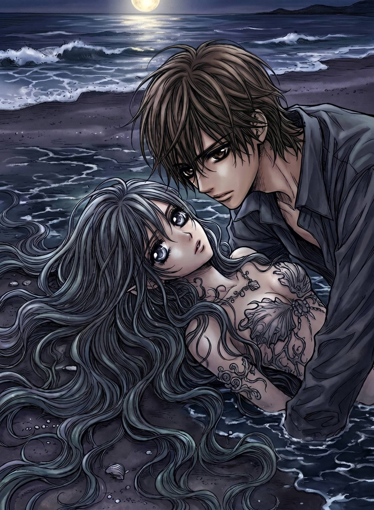

# 🌊 Undertow

*Once a year, on Halloween night, the sea lets her walk ashore.*

A melancholy gothic mermaid dress-up game made in a 24-hour Halloween jam.
She was human once — cursed into the sea to protect her. The man searching
for her is at the bonfire on the beach tonight. **What she wears writes what
the night becomes.**



## ▶️ Play

- **GitHub Pages:** https://yana205.github.io/undertow/
- **Vercel:** https://undertow-yana205.vercel.app/
  *(currently behind Vercel's login — in the Vercel dashboard: Project →
  Settings → Deployment Protection → disable "Vercel Authentication" to
  make it public)*

Desktop browser recommended. ~5 minutes per night; there are **four endings**
— one of them is hidden.

## How to play

1. Choose the tide you rise on — each of the four tails has a temperament.
2. Dress for the party. Every item carries a visible vibe:
   🌊 **Tide** (her sea nature) · 🎭 **Masque** (passing as human) ·
   🕯 **Memory** (the life she forgot).
3. Watch the man at the bonfire — he reacts to every item, without knowing why.
4. **Walk Ashore.** The dominant vibe decides how the night ends.

## Tech

- Vanilla HTML/CSS/JS — no engine, no build step. Stacked full-canvas PNG
  layers; a pure, unit-tested scoring module ([game/js/vibes.js](game/js/vibes.js)).
- All audio is synthesized at runtime with the Web Audio API — no samples.
- Asset pipeline in [tools/](tools): sheet slicing + background removal,
  anatomy-anchored garment fitting at the original pack's scale, hue-shifted
  hair variants.
- Design docs: [game-design.md](game-design.md) · research: [reference-board.md](reference-board.md)

### Run locally

```
python3 -m http.server 8321 -d game
```

then open http://localhost:8321 — no dependencies.

### Tests

```
node --test tests/vibes.test.mjs
```

## Credits & disclosure

By **Yana Ifraimov** — design, art direction, tech art. Built with Claude Code.
Mermaid bases and backgrounds include AI-generated imagery (Google Gemini),
human-curated; wardrobe garments adapted from the APC dress-up asset pack.
Title artwork and lore inspired by the mood of *Vampire Knight* — all
characters and setting are original. See [game/CREDITS.md](game/CREDITS.md).
