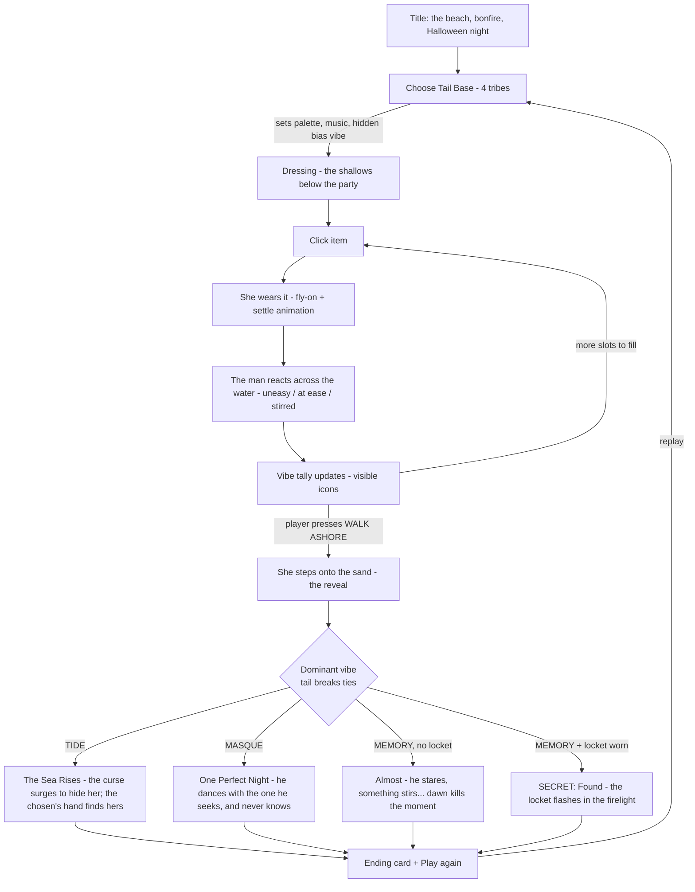

# Undertow — Game Design Document

**(working title — alternates: "The Tide Remembers", "One Night Ashore"; was "The Lure")**
**Halloween Jam 2026 · 24-hour solo build · Web (HTML/JS) · itch.io**

## Team & Roles
- **Yana**: Game Design, Tech Art (shaders, animation feel), Production — building with Claude Code

## Elevator Pitch

**Undertow** is a melancholy gothic dress-up game. Once a year, on Halloween night, the sea lets the mermaid walk ashore — and tonight there's a bonfire party on the beach, and *he* is there. The man she has watched from the water for years, in love without knowing why. What she can't remember: she was human once, and she was cursed into the sea **to protect her** — and he has been searching the shore for her ever since. She dresses in the shallows for the party, and what she chooses to wear decides the lore: whether she stays hidden and loses him… or whether, by accident, he *finds* her.

> Tone references: Vampire Knight's Kaname/Yuki dynamic (the devoted watcher, the forgotten rescue, sibling tragedy), Spiritfarer's "cozy about loss", rusalka/selkie folklore (clothing as identity — see [reference-board.md](reference-board.md)). Genre gap unchanged: scored dress-up is proven, but no dress-up game has a character who reacts live while you dress, and no gothic mermaid dress-up exists.

## The Lore (minimal, told almost entirely through items and endings; **no character names** — they are "the mermaid", "the man", "the chosen")

- **The mermaid** — she was **human first**. Years ago something was coming for her (danger never shown, only implied). To save her, she was **cursed into a mermaid** — hidden beneath the waves where nothing could reach her. The curse took her human memories as its price: the protection only holds while she is not known. She has watched a man on the shore for years and is in love with him **without knowing why**. Tonight, a Halloween party on the beach — masks and costumes — the one night a sea-thing could walk among humans unnoticed.
- **The man** — he is the one the curse hid her *from everyone for* — the one who loved her when she was human, and who has searched the shore for her ever since. He carries the twin of her locket; it is how he searches. Something pulls his eyes to the water; he doesn't know why. *(The locket she can wear is the one thing the curse let her keep from her human life — the proof.)*
- **The chosen** — her intended partner beneath the waves: patient, devoted, chosen by the sea. Appears only in endings — the hand that finds hers in the dark when she stays hidden. Not a villain; that's what makes it tragic.
- The sibling angle from the first draft is dropped; he is simply the one from her human life. Names are deliberately absent — the lore reads as a folktale.

## Core Loop (the 30-second test)

**Pick an item → she wears it instantly → across the water, the man reacts without knowing why → the vibe tally shifts.**
Action, feedback, reward, repeat — every click. Full session (~5 min): choose tail → dress 5 slots in the shallows while the party glows above → walk ashore → ending → replay to change the lore.

## Mechanic Diagram



## The Vibe System (gamibility)

Every wearable item carries exactly **one visible vibe**, shown as a small icon glint on the item and in the wardrobe:

| Vibe | Icon | Meaning | Example items |
|---|---|---|---|
| **Tide** 🌊 | wave | her sea nature, unhidden | pearl-fang charm, kelp wrap, coral crown, siren finery |
| **Masque** 🎭 | mask | passing as human — a party costume | Halloween mask, flower crown, human party wrap/scarf |
| **Memory** 🕯 | candle | relics of her human life, which she forgot | **the locket** (hero item), a faded ribbon, a scarf from the clothes she wore as a human |

- **Scoring**: count equipped vibes; the **dominant vibe** picks the ending branch.
- **Tail bias (hidden)**: the chosen tail adds **+1 silent vibe vote** — *Deep Current → Tide, Pale Pearlescent → Masque, Classic Oceanic → Memory, Shallow Reef → wild card (rolled once per night)*. Players discover tribe temperaments on replay.
- **Tie-break rule** (builder's call): on a tie for dominant, the vibe of the **most recently equipped** item among the tied wins — the player's visible choices always outrank the hidden bias; the bias decides only when no equipped item is among the tied (e.g. a naked walk-ashore). Deterministic, no UI, and "the last thing she reached for" reads as intent.
- **The secret ending gate**: Memory dominant **and the locket equipped** → *Found*. Memory dominant without the locket → *Almost* (the cruelest ending — a text/grade variant of the same scene, nearly free to build). The reveal is "accidental" in fiction: a wave catches her at the fire's edge and the locket swings into the light — she never chose to show it; the curse was never *broken*, only slipped.
- **Why visible icons**: players must read the language they're speaking (vibes shown) while still having things to discover (tail bias, the locket gate).

## The Endings (the lore the outfit writes)

| # | Condition | Ending | Emotional note |
|---|---|---|---|
| 1 | Tide dominant | **The Sea Rises** — her sea nature surges at the fire's edge; the curse does what it was made to do: it *hides* her. Waves climb the sand, the party scatters, she dives. From the black water she watches the bonfire gutter out. The chosen's hand finds hers. | She loses him — loudly; the protection wins |
| 2 | Masque dominant | **One Perfect Night** — she passes. He dances till dawn with the very person he has searched years for, and never knows. She says nothing — the curse protects her only while she is not known. The tide calls; he keeps the seashell she dropped. The chosen is waiting. | She loses him — quietly (the canonical tragedy) |
| 3 | Memory dominant, no locket | **Almost** — all night he stares at her, trying to place a word on the tip of his tongue. Dawn breaks. The moment dies. | The cruelest one |
| 4 | Memory dominant + locket | **SECRET: Found** — the wave, the swinging locket, firelight. He catches it: the twin of the one he carries, the one he has searched the shore with for years. He looks from the locket to her face — and *finds* her. The curse isn't broken; but she is no longer lost. | Bittersweet-good |

Endings are **composited scenes** (same beach painting re-graded + character poses + 1–2 lines of text), not new illustrations. The chosen appears as a silhouette in the water in endings 1–2 (one sprite, reused).

## The Man on the Shore (the live-reaction twist)

He stands at the bonfire's edge, nearest the water — he always ends up nearest the water — visible the whole time she dresses in the shallows below. He doesn't know he's reacting; **something he's searching for is close**:

- **Per-item micro-reaction** (instant, ~0.6s): equip a **Tide** item → the fire gutters, he glances at the sea uneasily; **Masque** → he relaxes, laughs with his friends (she could walk among them); **Memory** → he stops, touches the locket he carries, looks at the water a beat too long — *stirred*.
- **State tiers** (persistent posture = current dominant vibe): `uneasy` (tide) / `at_ease` (masque) / `stirred` (memory). Implemented as 3 pose sprites + 2–3 overlay expressions, crossfaded — **not frame animation**. Tweens and timing carry the acting.
- He never speaks during dressing. Max 1–2 text lines per ending (Vortella's lesson: text modals kill attention).
- **Staging (builder's call)**: one tall composition, one background painting. Upper third = the night beach: bonfire, partygoers as dark shapes, the man at the water's edge, lit by fire. Below the waterline = the moonlit shallows where she dresses. He is always visible while you dress. WALK ASHORE = push-in to the upper half of the same painting; endings re-grade and re-pose the same scene. One background (+ grade variants) fits the 1200×1800 portrait stage.

## Characters & Slots (technical design)

Layer stack, bottom → top (every layer a full-canvas PNG at (0,0) — no anchor math):

| z | Slot | Options (core / stretch) | Source |
|---|---|---|---|
| 0 | Background (shallows + beach party) | 1 (+grade variants) | generate |
| 1 | Hair **back** | part of hair choice | slice from sheets |
| 2 | **Tail+Body base** (never separated) | 4 | ✅ done — slice from sheet |
| 3 | Chest wrap / top | 3 (2 core +1) | generate (+ APC pack picks) |
| 4 | Neck jewelry | 3 (2+1) incl. **the locket** | generate |
| 5 | Hair **front** | **12 ✅ done** — slice from sheets (ship best 8–10) | done |
| 6 | Headpiece / mask / crown | 3 (2+1) | generate |
| 7 | Held item (mask-on-stick, lantern, seashell) | 3 (2+1) | generate |
| 8 | FX overlay (water glints, fire glow, grade) | shader/canvas | code |

- **Wearables total**: 12 hairs (done) + 8–12 generated = **20–24 items**, above the proven minimum (Fashion Battle ships ~15).
- Hairs carry vibes too (gothic hairs lean Tide, soft/seasonal lean Masque or Memory) — the done assets are free scoring content.
- **The APC human wardrobe is now canon twice over**: it is literally **the wardrobe of her human life**. Party garments = **Masque** items; pieces that read as *hers from before* (a worn scarf, a simple dress-top) = **Memory** items. Any piece that fits the mermaid torso after recolor saves a generation slot and deepens the lore for free.
- **One garment must fit all four bases** (builder's call + hour-0 check): the four bodies' chest lines match; align base slices by chest line; keep garments in the above-waist zone. **Hour 0**: test-fit one wrap on all 4 bases; fallback = 3-line per-tail y-offset table.

### Item data model

```js
// items.js — the whole game state language
{ id: "locket",  slot: "neck",  vibe: "memory",
  src: "items/locket.png", thumb: "thumbs/locket.webp",
  reaction: "stirred", hero: true }   // hero: true → the secret-ending key, glint highlight
```

Slots are mutually exclusive (equipping replaces). `vibe: null` allowed for pure-cosmetic stretch items. Tally = `count(equipped vibes)` + hidden tail vote; dominant wins, tie-break per rule above; ending = dominant, with the Memory branch split by `hero` item presence.

## Controls

| Input | What it does |
|---|---|
| Click/tap item thumbnail | Equip to its slot (replaces current) |
| Click equipped thumbnail | Unequip |
| Click tail portraits (start) | Choose tribe |
| **WALK ASHORE** button | Lock the look, trigger the reveal + ending |
| R on ending card | Replay |

Click-to-equip only. Mouse + touch both work.

## Game Feel / Animation Plan (the polish budget, in priority order)

1. **Equip feel**: item flies to her and *settles* (overshoot + ease), soft particle puff, one-note chime per vibe (3 notes = the leitmotif).
2. **The man's micro-reactions** — the signature. Pose crossfade + eased lean, fire-gutter flicker on Tide.
3. **Idle life**: hair sway, tail drift, bubbles below / fire sparks above the waterline, moon-glint caustics.
4. **The Walk Ashore reveal**: push-in to the beach, music swells, grade shifts to the dominant vibe's palette.
5. **Ending composites**: same scene re-graded + poses + 1–2 lines. The chosen's silhouette in endings 1–2. Stretch: one painted card for the secret ending only.
6. **Tribe tone**: per-tail palette grade + music filter. One shader, four presets.

Shared post-process over the whole stage (palette grade + grain + vignette) — hides AI style drift between assets.

## Asset Plan

### A. Slice the done sheets (~1h)
- Tail sheet → 4 **tail+body base** PNGs (key near-black bg; bodies stay attached), **aligned by chest line**.
- All three hair sheets (gothic ×4, mermaid ×4, seasonal ×4) → 12 **hair** PNGs (split front/back only where hair trails behind shoulders); ship best 8–10.
- Master canvas **1200×1800**; export WebP thumbs.
- **Verify the shared-torso assumption** with one test garment on all 4 bases before batch generation.

### B. Generate with Gemini (same style, on her base) (~5–6h)
Rules (pipeline research): inpaint/edit **on the locked base image**; **sheets of 3–6 items per call**; **neutral desaturated colors** (recolor later); plain `#00FF00` or black bg; 2–3px light outline; avoid lace/wisps; fresh chat every ~4 edits.

| Batch | Contents | Vibe spread |
|---|---|---|
| 1. Chest wraps ×3 | kelp wrap (Tide), human party top/shawl (Masque), a scarf from her human life worn as a wrap (Memory) | one per vibe |
| 2. Headpieces ×3 | coral crown (Tide), Halloween masquerade mask (Masque), faded ribbon (Memory) | one per vibe |
| 3. Neck jewelry ×3 | pearl-fang charm (Tide), festive beads (Masque), **the locket** (Memory, hero) | one per vibe |
| 4. Held items ×3 | sea-glass lantern (Tide), mask-on-stick (Masque), a seashell from the night she was cursed (Memory) | unfitted — plain bg, position by hand |
| 5. The man | young man at a bonfire, 3 poses (uneasy / at ease / stirred) + 2 face overlays, firelit, waist-up, same art style | one sheet |
| 6. Background ×1 + the chosen | **one vertical night scene**: bonfire beach party upper third (his spot at the water's edge), moonlit shallows below; + 1 silhouette-in-water sprite for the chosen | endings reuse with grade/pose changes |

Cutout: BiRefNet/rembg `isnet-anime` + hand cleanup. **Time math**: 12 items ≈ 5h, Kai ≈ 1h, background+Thal ≈ 45min → ~6.75h art ⊂ 8h budget. Core = 2 items/slot if behind — see cut-list. APC-pack substitutions (Masque/Memory garments) reclaim ~25min each.

### C. Disclosure & jam rules — RESOLVED
Jam rules confirmed by Yana (2026-10-30): **no restrictions** — AI art and pre-made assets allowed. itch.io **GenAI disclosure: yes** (Gemini-generated art, human-curated). If the jam announces a theme word, flex points are the four ending texts, item theming, and the title.

## Technical Design

- **Stack**: one `index.html` + vanilla JS + CSS. No engine, no build step. Stage = fixed-aspect box, stacked absolutely-positioned `` layers by z (the [hackrew](https://github.com/ksadov/hackrew) pattern: data order = z-order). Canvas/WebGL only for the shared grade if CSS filters fall short.
- **Data**: `items.js` array (schema above) + `tails.js` (bias vibe, palette, music preset) + `ENDINGS` (4 entries; `almost` and `remembers` share the Memory branch, split by the hero item).
- **Preload**: `Promise.all` + `img.decode()` per category behind the title screen.
- **Audio**: Web Audio; one ambient loop (waves + distant party), 3 vibe chimes, 4 ending stingers.
- **Deploy**: zip with `index.html` at root → itch.io HTML5; embed sized to stage aspect; test the uploaded build at **hour ~8**. Case-sensitive filenames.
- **Desktop story**: the web build IS the desktop build (fullscreen in any browser). Optional post-jam: wrap for Mac.

## 24-Hour Schedule

| Hours | Work | Milestone |
|---|---|---|
| 0–1 | Project setup, slice tail bases + 3 hairs, **test-fit one garment on all 4 bases** | assets on a canvas, fit confirmed |
| 1–3 | Layer engine, wardrobe UI, click-to-equip, items.js with placeholder art | **she dresses (gray-box)** |
| 3–4 | Vibe tally + tail bias + locket gate + 4 text endings | **game completable, secret reachable** |
| 4–6 | The man's placeholder + reaction tiers + micro-reaction hooks | full loop feels right |
| 6–8 | **First itch.io upload test**; Gemini batches 1–3 running while fixing | deployed early |
| 8–12 | Cut out + integrate items; the man's art + expressions; remaining hairs; APC substitutions | real art in |
| 12–16 | Juice pass 1: equip feel, idle life, tribe tone presets, music/SFX | it feels alive |
| 16–19 | Walk Ashore reveal + ending composites + the chosen's silhouette + title screen | the emotion lands |
| 19–21 | Juice pass 2: the man's acting polish, grade, grain | signature moments |
| 21–23 | Playtest (3 people if possible), bugfix, browser/touch check, re-upload | stable build |
| 23–24 | itch page (cover gif!), GenAI disclosure, submit | **shipped, with buffer** |

### Cut-list (when behind, cut in this order — never below the line)
1. Stretch items (3rd per slot) → 2 per slot
2. Per-item micro-reactions → keep only the 3 posture tiers
3. Held-item slot entirely
4. Tribe music variations → one track, palette grade only
5. The chosen's silhouette → endings 1–2 mention him in text only
6. Painted secret-ending card → text + composite (already the plan)
7. — **never cut**: the 4 endings (Almost is a text variant — it stays), the equip feel, the Walk Ashore reveal, the locket gate

## What Sets It Apart
- **He reacts while you dress, and doesn't know why** — feedback as longing; no comp does this.
- **Scoring you can read, a secret you can find** — visible vibes; hidden tail temperaments; the locket gate rewards attentive replayers.
- **A dress-up game about loss** — the Halloween feeling nobody builds: not horror — grief, and one impossible good ending.

## Q&A — Anticipated Questions

**Q: Why no score number or stars?**
A: The ending *is* the score. Four tiers of emotional outcome replace points; replay value is steering the lore.

**Q: What if the player equips nothing and walks ashore?**
A: Tail bias alone decides (Shallow Reef makes it a coin flip). Oceanic naked-walk = Memory without the locket = *Almost* — a legal, darkly funny speedrun.

**Q: How does a player find the secret ending?**
A: The locket glints in the wardrobe (hero highlight) and the man's *stirred* reaction to Memory items teaches the direction. Memory-dominant without the locket lands on *Almost*, whose text hints that something was missing.

**Q: Is this Vampire Knight fan content?**
A: No — it borrows the emotional dynamic (the devoted searcher, the forgotten past, a protection that costs the protected her memory), with an original folktale setting and deliberately unnamed characters.

**Q: Mobile?**
A: Touch works (click-to-equip), but the jam target is desktop browser; itch mobile embed is a bonus, tested once at hour ~21.
